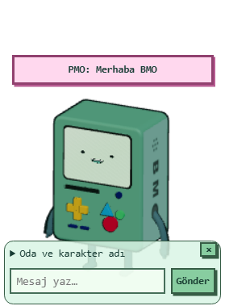

# BMO Desk

Windows masaüstünde yaşayan iki 3B arkadaş. BMO ile Spotify'ı yönetebilir, oda kodunu bir arkadaşınla paylaşarak pembe PMO ile iki masaüstü arasında sohbet edebilirsin. Çalan şarkı karakterin üstündeki düşünce balonunda görünür.

## BMO'nun tuşları

| Tuş | İşlev |
| --- | --- |
| Sarı artı ↑ / ↓ | Spotify sesini artır / azalt |
| Sarı artı ← / → | Önceki / sonraki şarkıya geç |
| Kırmızı düğme | Duraklat / devam et |
| Mavi üçgen | Dans et |
| Yeşil düğme | Odayı ve sohbeti aç |

Sohbet panelini başlığından tutup masaüstünde istediğin yere sürükleyebilirsin. Panelde karakter adını değiştirebilirsin. Uygulamayı kapatmak için Windows sistem tepsisindeki BMO simgesinin menüsünü kullan.

## Kurulum

1. `npm ci`
2. `.env.example` dosyasını `.env` olarak kopyalayın ve Spotify Developer uygulamanızın Client ID değerini girin.
3. Spotify Developer uygulamasına `http://127.0.0.1:43891/callback` yönlendirme adresini ekleyin.
4. `npm start` ile BMO'yu açın. Bağlantı panelinden **Spotify ile bağlan** düğmesine basın.

## Oda, sohbet

- Yeşil tuş oda panelini açar. Uygulama dört rakamlı `BMO-0000` biçiminde kod üretir. Diğer bilgisayarda kodu girip **Bağlan** düğmesine basın.
- `C` tuşu sohbet kutusunu açar. Mesajlar iki karakterin konuşma balonunda dört saniye görünür.
- Oda kodunu paylaşan yeşil BMO, kodu giren pembe PMO olur. Sohbet adı otomatik atanır. Şarkı bilgisi karakterin üstündeki balonda görünür.
- Karakteri ekranın yanından fırlattığınızda konum ve hız ekran boyutuna göre ölçeklenerek diğer bilgisayara gönderilir. Karakter görev çubuğuna çarparak seker.
- PeerJS Cloud ücretsiz buluşma sunucusunu kullanır. Veri kanalı uygun ağlarda doğrudan eşler arasında kurulur; kimi ağlarda TURN aktarımı gerekebilir. İnternet bağlantısı gerekir.

Dağıtım paketinde `.env`, `BMO Desk.exe` ile aynı klasörde bulunmalıdır. `.env` dosyasını sürüm kontrolüne eklemeyin. PKCE kullanıldığı için uygulamada Client Secret bulunmaz. Erişim ve yenileme belirteçleri proje içinde saklanmaz; Windows güvenli depolamasıyla şifrelenip kullanıcı veri dizinine yazılır.

## Mimari

- `main.cjs`: Electron başlangıcı, tepsi ve IPC bağlama.
- `services/config.cjs`: `.env` okuma ve doğrulama.
- `services/tokenStore.cjs`: şifreli oturum saklama ve eski kayıtların taşınması.
- `services/spotifyAuth.cjs`: PKCE yetkilendirme akışı.
- `services/spotifyApi.cjs`: yetkili HTTP istekleri ve belirteç yenileme.
- `services/playerService.cjs`: oynatma ve ses komutları.
- `connectionPanel.js`: bağlantı arayüzünün durum yönetimi.
- `multiplayer.js`, `roomPanel.js`, `transferMath.js`: eş bağlantısı, sohbet arayüzü ve ekranlar arası hareket.
- `vendor/peerjs.min.js`: yerel PeerJS istemcisi (lisansı `vendor/PEERJS-LICENSE.txt`).
- `src/referenceModel.js` karakter geometrisini, `src/renderer.js` sahneyi ve etkileşimleri tanımlar. Kaynakları değiştirdikten sonra `npm run build:renderer` ile `renderer.bundle.js` dosyasını üretin.

`npm test` yapılandırmayı, oturum geçişini ve oynatma API yanıtlarını sınar.
